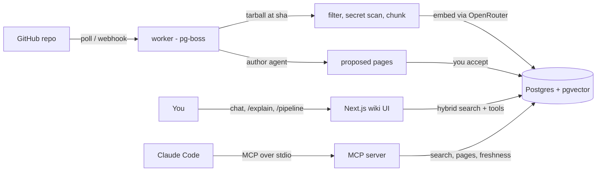

# LLM Repo Wiki

**A wiki that writes and maintains itself from your GitHub repos.**

It applies Andrej Karpathy's [LLM Wiki](https://gist.github.com/karpathy/442a6bf555914893e9891c11519de94f)
idea to code. An agent reads your repositories and writes a wiki in which every claim cites the exact
lines it came from. When a PR merges, the agent updates only the pages that change affected. You can
chat with the wiki, and the chat can edit it too.

> DeepWiki-style tools regenerate their docs. This one *maintains* them, and hands every change to you
> as a reviewable diff.

[](https://github.com/lucaslimafons/llm-repo-wiki/actions/workflows/ci.yml)


This is a study project for learning retrieval-augmented generation (RAG) end to end. It runs
locally with `docker compose` and `pnpm`, and is not meant to be deployed: there is no login, by
design, so everything binds to `127.0.0.1`.

## What it does

- **Ingests GitHub repos, public or private.** A tarball pinned to a commit, with binaries,
  lockfiles, generated code and any file holding a secret dropped before anything is embedded.
- **Searches with hybrid retrieval.** Code is chunked by its syntax (tree-sitter); pgvector
  similarity and Postgres full-text search are fused with reciprocal rank fusion in one SQL query.
- **Writes the wiki.** A background *author* agent plans an outline from
  [`WIKI_SCHEMA.md`](WIKI_SCHEMA.md) and drafts each page from evidence it retrieves itself. Any
  citation that doesn't point inside that evidence is removed. Pages arrive as **proposals** you
  accept or reject.
- **Stays fresh.** A worker polls each repo's default branch, re-indexes only changed files, marks
  the pages that cite them as stale, and proposes updates.
- **Chats with tools.** Search, read, create, update, move and delete pages; destructive actions
  wait for your approval. Answers cite GitHub permalinks to the exact commit and lines.
- **Shows its work.** `/pipeline` draws a repo's run as stages on a board, live or as a replay.
  `/explain` steps through retrieval for any question: both search lists, the fusion, and which
  citations in an answer survive grounding.
- **Keeps projects apart.** One instance holds several wikis, one per project. Each has its own
  repos, pages, chats and brief; search, chat and the author never cross from one to another.
- **Answers Claude Code directly.** A local [MCP server](docs/mcp.md) gives Claude Code the same
  search over a wiki's repos, its pages, and how fresh the index is.
- **Exports plain markdown.** `pnpm export` writes the accepted wiki as files that render on GitHub.

## Quick start

Requirements: Node 22+, pnpm, Docker, and an [OpenRouter](https://openrouter.ai) account with
credits. Before you add any private code, read [what leaves your machine](docs/privacy.md).

```bash
git clone https://github.com/lucaslimafons/llm-repo-wiki && cd llm-repo-wiki
cp .env.example .env.local        # add OPENROUTER_API_KEY
pnpm install
pnpm db:setup                     # Postgres 18 + pgvector in Docker, then migrations
pnpm dev                          # http://127.0.0.1:3000
pnpm worker                       # second terminal: sync + author jobs
```

Open the app, create a wiki for your project, and add a repo with the sidebar's **Add repository**
box (or `pnpm repo:add pmndrs/zustand --wiki <slug>`).

The first sync takes seconds. The first wiki takes about 10 minutes and costs about $0.10. Review
its pages under **Proposals**, and watch the run under **Pipeline**.

## How it works



The design follows Karpathy's three layers:

- **Sources:** repo files at a commit, chunked and embedded, never modified.
- **The wiki:** compiled, maintained knowledge.
- **The schema:** [`WIKI_SCHEMA.md`](WIKI_SCHEMA.md), the conventions the agent writes by.

Notable choices: no Redis (the job queue lives in the same Postgres), no agent framework (the RAG
pipeline is plain code, so every step is visible), and zod at every boundary.
[`docs/plan.md`](docs/plan.md) has every design decision and its reasoning.

## Results

Live runs on [`pmndrs/zustand`](https://github.com/pmndrs/zustand) (`382d29c`, 128 files, 702
chunks) on 2026-10-22:

| What | Result | Cost |
|---|---|---|
| Retrieval: right file in the top 5 (20 questions) | hybrid 16/20 · hybrid + reranker 19/20 | reranker +$0.0025 per search |
| Chat: answers grounded in the right file (6 questions) | 6/6 with Claude Haiku 5.5, 9.9 s per answer | $0.003 per answer |
| Author: a full wiki | 24 of 24 pages, 276 citations, 0 invented | $0.09 |
| Embedding the whole repo | 702 chunks | under $0.01 |
| Updating after a merge | only the affected pages | about $0.004 per page |

```bash
pnpm eval
pnpm bench:chat anthropic/claude-haiku-5.5 z-ai/glm-5.3-flash
pnpm bench:author anthropic/claude-haiku-5.5 pmndrs/zustand --wipe   # deletes that repo's wiki pages first
```

These are small samples on one repo; a gap of one answer is within noise. Method, charts and the
failures the live runs exposed are in [`docs/evals.md`](docs/evals.md); per-model numbers are in
[`docs/models.md`](docs/models.md). A larger repo (about 750 files) wrote 20 pages for $0.10, which
is why one author run may spend up to 800k tokens (about $0.20).

## Documentation

| Page | What's in it |
|---|---|
| [Configuration and scripts](docs/configuration.md) | Every `.env.local` setting, the webhook, all `pnpm` scripts, troubleshooting |
| [Repositories](docs/repositories.md) | Private repos and tokens, and documenting several repos as one project |
| [Use it from Claude Code](docs/mcp.md) | The MCP server: set up, tools, and how to measure it against grep |
| [Privacy](docs/privacy.md) | What leaves your machine, and the OpenRouter settings to change |
| [Models and retrieval](docs/models.md) | Why these models, and the reranker numbers |
| [Evals](docs/evals.md) | The full eval write-up |
| [Design plan](docs/plan.md) | Every design decision and its reasoning |
| [Security](SECURITY.md) | Threat model, defenses, and how to report a vulnerability |

## Stack

Next.js 16 (App Router) · React 19 · TanStack Query · Tailwind 4 · Vercel AI SDK 7 · OpenRouter ·
Postgres 18 + pgvector 0.8 · Drizzle · pg-boss · tree-sitter ([`code-chunk`](https://github.com/supermemoryai/code-chunk)) ·
MCP TypeScript SDK · zod 4 · Vitest against real Postgres · gitleaks in CI.

## Limitations

- **Local and single-user.** There is no login. The Stop button's in-memory run registry assumes
  one web process.
- **Languages:** syntax-aware chunking for TypeScript, JavaScript, Python, Go, Rust and Java.
  Other files are indexed in 60-line windows.
- **Files over 300 KB, binaries, lockfiles and generated code** are skipped.
- **Citations are grounded, not proven.** A citation is checked to point at retrieved code. Whether
  the sentence says the same thing as that code is not checked.
- **No reranking in search.** It measured best, but no rerank model on OpenRouter offers zero data
  retention ([details](docs/models.md#retrieval-and-reranking)).

## Roadmap

- An LLM-judge pass that checks each cited sentence says what its source says.
- When a parent page fails to draft, write a placeholder parent instead of dropping its children.
- Publish the MCP-vs-grep benchmark on public repos.
- Evals on more repos and languages.
- Several isolated wikis per instance ([#7](https://github.com/lucaslimafons/llm-repo-wiki/issues/7)).

Ideas and bugs are welcome as [issues](https://github.com/lucaslimafons/llm-repo-wiki/issues). It's
a single-maintainer study project, so pull requests are considered case by case.

## Credits

- Andrej Karpathy's [LLM Wiki](https://gist.github.com/karpathy/442a6bf555914893e9891c11519de94f) idea.
- [cAST](https://arxiv.org/abs/2506.15655) and [code-chunk](https://github.com/supermemoryai/code-chunk)
  for chunking code by its syntax tree.
- Anthropic's [contextual retrieval](https://www.anthropic.com/news/contextual-retrieval) write-up.

## License

[MIT](LICENSE)
