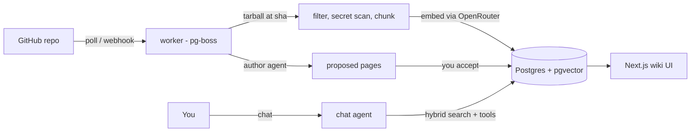

# LLM Repo Wiki

**A wiki that writes and maintains itself from your GitHub repos.**

It applies Andrej Karpathy's [LLM Wiki](https://gist.github.com/karpathy/442a6bf555914893e9891c11519de94f)
idea to code. An agent reads your repositories and writes a wiki in which every claim cites the exact
lines it came from. When a PR merges, the agent updates only the pages that change affected. You can
chat with the wiki, and the chat can edit it too.

> DeepWiki-style tools regenerate their docs. This one *maintains* them, and hands every change to you
> as a reviewable diff.

[](https://github.com/lucaslimafons/llm-repo-wiki/actions/workflows/ci.yml)


This is a study project for learning retrieval-augmented generation (RAG) end to end. It runs
locally with `docker compose` and `pnpm`, and is not meant to be deployed: there is no auth by
design.

## Stack

| Layer | Tech |
|---|---|
| App | Next.js 16 (App Router), React 19, TanStack Query, Tailwind 4 |
| LLMs | Vercel AI SDK 7 (`ToolLoopAgent`, tool approvals), OpenRouter |
| Data | Postgres 18 + pgvector 0.8 (HNSW + full-text), Drizzle ORM |
| Retrieval | tree-sitter chunking ([`code-chunk`](https://github.com/supermemoryai/code-chunk)), hybrid RRF, optional Cohere rerank |
| Jobs | pg-boss: queue, retries and schedules in the same Postgres |
| Quality | zod 4 at every boundary, Vitest against real Postgres, gitleaks in CI |

Notable choices:

- **No Redis.** The job queue lives in the same Postgres.
- **No agent framework.** The RAG pipeline is written in plain code, on purpose, so every step is
  visible.
- **No `useEffect`.** A lint rule enforces it.

## What it does

- **Ingests GitHub repos.** It downloads a tarball pinned to a commit, filters out binaries, lockfiles
  and generated code, and scans for secrets before anything is embedded.
- **Chunks code by its syntax.** Code is split with tree-sitter ([`code-chunk`](https://github.com/supermemoryai/code-chunk),
  an implementation of the cAST method); markdown is split by headings.
- **Hybrid search on Postgres.** pgvector (HNSW index) and Postgres full-text search, fused with
  reciprocal rank fusion (RRF) in one SQL query, with an optional Cohere reranker.
- **Writes the wiki.** A background *author* agent plans an outline from `WIKI_SCHEMA.md` and drafts
  each page from evidence it retrieves. Any citation that doesn't point inside that evidence is
  removed. Pages arrive as **proposals** you accept or reject.
- **Chats with tools.** The agent can search, read, create, update, move and delete pages, and
  delete, move and overwrite wait for your approval. Every answer lists its sources as GitHub
  permalinks to the exact commit and lines. Sessions are saved, so the agent remembers the
  conversation when you come back.
- **Stays fresh.** A worker polls each repo's default branch (or receives a GitHub webhook),
  re-indexes only the changed files, marks the pages that cite them as stale and proposes updates.
- **Exports to Azure DevOps.** Postgres is the source of truth; `pnpm export` writes an Azure
  DevOps-compatible wiki folder (`Page.md` + `Page/`, `.order`, encoded filenames).

## How it works



The design follows Karpathy's three layers:

- **Sources:** repo files at a commit, chunked and embedded, never modified.
- **The wiki:** compiled, maintained knowledge.
- **The schema:** [`WIKI_SCHEMA.md`](WIKI_SCHEMA.md), the conventions the agent writes by.

[`docs/plan.md`](docs/plan.md) has every design decision and its reasoning.

## Quick start

Requirements: Node 22+, pnpm, Docker, and an [OpenRouter](https://openrouter.ai) API key with
credits. Give it a dedicated key with a spending limit.

```bash
git clone https://github.com/lucaslimafons/llm-repo-wiki && cd llm-repo-wiki
cp .env.example .env.local        # add OPENROUTER_API_KEY
pnpm install
pnpm setup                        # Postgres 18 + pgvector in Docker, then migrations
pnpm dev                          # http://localhost:3000
pnpm worker                       # second terminal: sync + author jobs
pnpm repo:add pmndrs/zustand      # or use the "Add repository" box in the sidebar
```

The first sync takes a few seconds; the first wiki, about 10 minutes and about $0.10. Review the
pages under **Proposals**.

## Scripts

| Command | What it does |
|---|---|
| `pnpm setup` | Start Postgres in Docker and run migrations |
| `pnpm dev` / `pnpm worker` | Web app / background job worker |
| `pnpm repo:add owner/name` | Add a repo and queue its first sync |
| `pnpm export --out <dir>` | Write the wiki as an Azure DevOps folder |
| `pnpm eval`, `pnpm bench:*` | Retrieval eval and model benchmarks |
| `pnpm test` / `pnpm typecheck` / `pnpm lint` | 250 tests against a real Postgres, plus checks |

## Results

The defaults come from measured runs, not guesses. They were evaluated live on
[`pmndrs/zustand`](https://github.com/pmndrs/zustand) (`382d29c`, 128 files) on 2026-10-22.

| | Pick | Measured |
|---|---|---|
| Chat model | `anthropic/claude-haiku-5.5` | 6/6 answers cited the file holding the answer, at $0.003 and 9.9 s each. Sonnet 5.5 also got 6/6, at 22× the cost |
| Author model | `anthropic/claude-haiku-5.5` | The only model to finish a full wiki: 24/24 pages, 276 citations, 0 invented, $0.09 |
| Retrieval | hybrid + `cohere/rerank-4-pro` | Recall@5 of 0.95, against 0.85 for vector-only and 0.80 for plain hybrid RRF |

Cheaper models failed in ways a price list doesn't show. One reasoned until its token cap and
returned nothing; another planned well but wrote 1 page of 26. Tables per model:
[`docs/models.md`](docs/models.md). Reproduce them:

```bash
pnpm eval                                              # retrieval: 8 strategies, recall@5 / MRR
pnpm bench:chat anthropic/claude-haiku-5.5 z-ai/glm-5.3-flash
pnpm bench:author anthropic/claude-haiku-5.5 pmndrs/zustand --wipe   # deletes all wiki pages first
```

## Security

The agent reads code from repositories you don't control and can write to the wiki, so:

- **Retrieved text is data, never instructions.** It reaches the model inside `<retrieved>` tags,
  and any closing tag inside the content is escaped.
- **Tools are least-privilege.** Write tools can only touch the wiki store: no GitHub token, env,
  shell or network. Page ids are resolved on the server, never taken from the model.
- **Destructive actions need your approval.** The approval requests are HMAC-signed, so the browser
  cannot forge one. The background agent can only *propose*.
- **Secrets are never indexed.** Files with key-shaped content are dropped before embedding, and the
  log names the rule, never the value.
- **Rendering is sanitized.** Markdown goes through `rehype-sanitize`, and only `http(s)` and
  relative links survive.
- **Nothing is exposed.** Docker ports bind to `127.0.0.1`, and the GitHub webhook checks
  `X-Hub-Signature-256` with a timing-safe compare.
- **Every boundary is validated with zod:** env, tool inputs, GitHub responses, and API responses.

## Roadmap

- Turn the reranker on by default (+$0.0025 and +0.65 s per search).
- When a parent page fails to draft, write a placeholder parent instead of dropping its children.
- An LLM-judge pass that checks each cited sentence actually says what its source says.
- Evals on more repos and languages.

## Credits

- Andrej Karpathy's [LLM Wiki](https://gist.github.com/karpathy/442a6bf555914893e9891c11519de94f) idea.
- [cAST](https://arxiv.org/abs/2506.15655) and [code-chunk](https://github.com/supermemoryai/code-chunk)
  for chunking code by its syntax tree.
- Anthropic's [contextual retrieval](https://www.anthropic.com/news/contextual-retrieval) write-up.

## License

[MIT](LICENSE)
