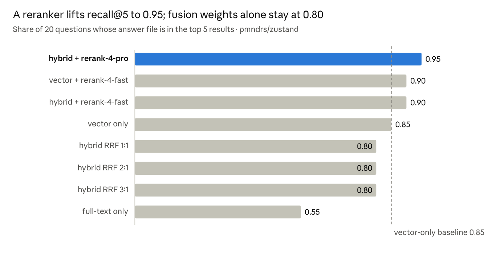
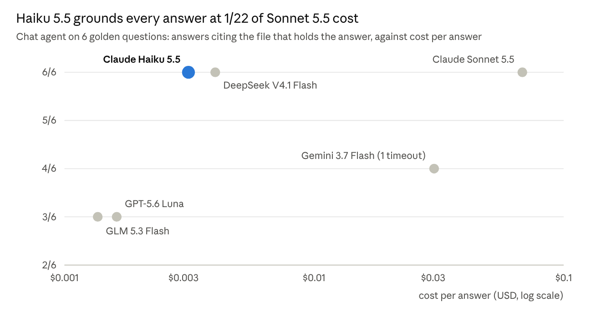

# Model and retrieval evals

2026-10-22 · Lucas Fonseca

These are the live evals behind the defaults in the [README](../README.md). Every number comes from
real runs of this project against one repository, through OpenRouter.

## TL;DR

Use Claude Haiku 5.5 for both chat and wiki writing, and hybrid search plus a reranker for retrieval.
On zustand that set-up wrote a 24-page wiki with 276 citations, none invented, for $0.09, and answered
chat questions at $0.003 each.

| Decision | Pick | Evidence |
| --- | --- | --- |
| Chat model | `anthropic/claude-haiku-5.5` | 6/6 grounded answers, $0.0031 and 9.9 s each; Sonnet 5.5 also 6/6 at 22× the cost |
| Author model | `anthropic/claude-haiku-5.5` | Only model to finish a full wiki: 24/24 pages, 0 invented citations, $0.091 |
| Retrieval | hybrid + `cohere/rerank-4-pro` | Recall@5 0.95 vs 0.85 vector-only and 0.80 plain hybrid; +$0.0025 and about +0.7 s per search |

The reranker is measured here but not yet used by the app; the app searches with plain hybrid RRF
today. See [Reranking](../README.md#reranking-measured-not-yet-on) in the README.

The cheapest models failed in ways a price list doesn't show:

- **DeepSeek V4 Flash** reasoned until its token cap and returned nothing.
- **GLM 5.3 Flash** planned well but wrote 1 page of 26.
- **Plain hybrid search** did worse than vectors alone.

## Setup

- **The app.** A Karpathy-style [LLM Wiki](https://gist.github.com/karpathy/442a6bf555914893e9891c11519de94f)
  over GitHub repos. Repos are chunked (tree-sitter for code, headings for markdown), embedded with
  `openai/text-embedding-3-small`, and stored in Postgres 18 + pgvector 0.8.7.
- **Test repo.** [pmndrs/zustand](https://github.com/pmndrs/zustand) at commit `382d29c`. It has 128
  indexed files and 702 chunks; 2 files were dropped by the filters.
- **Two LLM roles.** The *chat* model answers you live and calls tools (search, read,
  create/update/move pages). The *author* model writes the wiki in the background after each sync: it
  plans an outline, then drafts each page with citations.
- **Measurement.** Token counts and cost come from OpenRouter's per-call usage accounting
  (`usage.cost`), summed into the `agent_runs` table. Times are wall clock on a laptop.
- **Grounding check.** The author job retrieves the evidence itself. Any citation that points outside a
  retrieved chunk is stripped as invented, and a page left with no valid citation is dropped.

## Candidates

Eight models were shortlisted from about 130 tool-capable models on OpenRouter, by price and by
OpenRouter's own [τ²-Bench Airline](https://openrouter.ai/benchmarks/tau2-bench-airline) tool-calling
score. Prices are USD per million tokens, from the [OpenRouter models API](https://openrouter.ai/api/v1/models).

| Model | Input $/M | Output $/M | Context | τ²-Bench | τ² cost/task |
| --- | --- | --- | --- | --- | --- |
| `anthropic/claude-sonnet-5.5` | 2.00 | 10.00 | 1M | 78.7% | $0.16 |
| `google/gemini-3.7-flash` | 0.75 | 3.75 | 1M | 78.3% | $0.15 |
| `deepseek/deepseek-v4.1-flash-1017` | 0.15 | 0.60 | 1M | 76.7% | $0.021 |
| `anthropic/claude-haiku-5.5` | 0.10 | 0.50 | 1M | 76.0% | $0.011 |
| `z-ai/glm-5.3-flash` | 0.005 | 0.20 | 1M | 75.9% | $0.007 |
| `deepseek/deepseek-v4-flash-0731` | 0.044 | 0.133 | 1M | 73.9% | $0.009 |
| `qwen/qwen3.8-flash` | 0.15 | 0.47 | 1M | 71.3% | $0.017 |
| `openai/gpt-5.6-luna` | 0.20 | 1.20 | 1M | 70.0% | $0.011 |

τ²-Bench simulates airline customer support. It measures multi-step tool calling, not doc writing or
citation honesty, which is why the evals below exist.

## Eval 1: Outline reliability

Only Claude Haiku 5.5 and GLM 5.3 Flash planned a usable outline on both runs. Each model got the same
prompt twice: the repo's file tree, its README chunks and the wiki schema, asking for a JSON outline of
at most 30 pages.

| Model | Run 1 | Run 2 | Reasoning tokens | Time/call | Cost/call | Verdict |
| --- | --- | --- | --- | --- | --- | --- |
| `z-ai/glm-5.3-flash` | 28 pages | 27 pages | ~0 | 11 s | $0.0005 | Consistent, cheapest |
| `anthropic/claude-haiku-5.5` | 28 pages | 28 pages | ~1,100 | 15 s | $0.0022 | Consistent, clean paths |
| `deepseek/deepseek-v4.1-flash-1017` | 28 pages | 1 page | ~2,300 | 27 s | $0.0016 | Inconsistent; put `.md` in page paths |
| `deepseek/deepseek-v4-flash-0731` | 0 pages | no output | ~14,400 | 50 s | $0.0035 | Reasoning runs away |
| `qwen/qwen3.8-flash` | no output | not run | n/a | 265 s | n/a | Hung, then failed |

DeepSeek V4 Flash 0731 ignored the reasoning-effort setting. With `reasoning: "none"` it still
reasoned until the 16,000-token cap and wrote nothing.

## Eval 2: Full wiki generation

Only Claude Haiku 5.5 wrote a complete wiki: 24 of 24 planned pages, 276 citations, none invented, for
$0.091. Each model ran the real author job from an empty wiki: it plans an outline, retrieves evidence
per page, drafts, then grounds every citation against that evidence.

| Model | Pages written | Citations | Invented, stripped | Tokens in / out | Cost | Time |
| --- | --- | --- | --- | --- | --- | --- |
| `anthropic/claude-haiku-5.5` | 24 of 24 | 276 | 0 | 265k / 129k | $0.091 | 9.6 min |
| `z-ai/glm-5.3-flash` | 1 of 26 | 14 | 1 | 47k / 35k | $0.015 | 13 min |
| `deepseek/deepseek-v4.1-flash-1017` | 1 of 27 | 20 | 0 | 27k / 18k | $0.020 | 1.8 min |
| `deepseek/deepseek-v4-flash-0731` | 0 | n/a | n/a | n/a | n/a | n/a |

Why the others failed:

- **GLM 5.3 Flash** planned well (Eval 1) but could not write pages. Drafts hit the 120 s timeout,
  returned no output, or cited nothing retrieved. A first run failed outright on a timeout; this table
  shows the second.
- **DeepSeek V4.1 Flash** ignored the wiki schema and planned one page per file (`src/vanilla.ts`,
  `tests/basic.test.tsx`). Its pages then had no parents, so 22 of 27 were dropped.
- **DeepSeek V4 Flash 0731** never got past the outline (Eval 1).

A failed parent drops all its children, which made the GLM and DeepSeek V4.1 results worse than one bad
page each. Writing a citation-free folder page for a failed parent would contain that damage, and is
the next change worth making.

## Eval 3: Retrieval

Hybrid search plus a reranker found the right file for 19 of 20 questions, against 17 for vector-only
and 16 for plain hybrid. Each question has a known answer file, and a hit means that file is in the
top 5 results.



*`pnpm eval` · 20 golden questions ([`eval/golden.json`](../eval/golden.json)) · text-embedding-3-small · 2026-10-22*

Weighting the fusion toward vectors improved ranking but not recall. The reranker reorders the top 30
candidates and costs time and a little money:

| Strategy | MRR@10 | Latency/query | Cost/query |
| --- | --- | --- | --- |
| hybrid + rerank-4-pro | 0.735 | 1,266 ms | $0.0025 |
| vector + rerank-4-fast | 0.706 | 1,058 ms | $0.002 |
| hybrid + rerank-4-fast | 0.693 | 1,164 ms | $0.002 |
| hybrid RRF 3:1 | 0.651 | 607 ms | $0 |
| vector only | 0.630 | 675 ms | $0 |
| hybrid RRF 2:1 | 0.617 | 614 ms | $0 |
| hybrid RRF 1:1 | 0.601 | 591 ms | $0 |
| full-text only | 0.369 | 18 ms | $0 |

Latency includes one embedding call to OpenRouter (~550 ms) for every strategy except full-text.
Full-text alone missed 9 of 20, mostly conceptual questions ("create a store without React") with no
shared keywords.

## Eval 4: Chat

Claude Haiku 5.5 grounded all 6 answers at $0.003 each and was the fastest; Claude Sonnet 5.5 matched
it at 22 times the cost. Each model ran the real chat agent, with the same tools, prompt and 8-step cap,
on 6 golden questions. An answer counts as grounded when it cites the file that holds the answer.



*`pnpm bench:chat` · first 6 questions of `eval/golden.json` · real chat agent, 8-step cap · 2026-10-22*

| Model | Seconds/answer | Searches/answer | Citations/answer | Failures |
| --- | --- | --- | --- | --- |
| Claude Haiku 5.5 | 9.9 | 2.2 | 7.7 | 0 |
| Claude Sonnet 5.5 | 14.5 | 2.0 | 9.3 | 0 |
| DeepSeek V4.1 Flash 1017 | 14.7 | 2.8 | 12.0 | 0 |
| GPT-5.6 Luna | 14.9 | 4.2 | 2.2 | 0 |
| GLM 5.3 Flash | 20.7 | 1.5 | 7.0 | 0 |
| Gemini 3.7 Flash | 42.3 | 3.2 | 8.2 | 1 timeout |

GLM 5.3 Flash, the best outline planner in Eval 1, searched least and missed half the questions as a
chat agent. GPT-5.6 Luna searched most but rarely cited what it found.

## Failure modes found

Five failures showed up in the first live runs, none of them in the mocked test suite. Each one changed
the pipeline.

| # | What happened | Cause | Fix |
| --- | --- | --- | --- |
| 1 | The outline came back as one placeholder page (`"purpose": "..."`) | Tools plus JSON output in one loop: the API asks for JSON on every step, so the model answers before it searches | The job retrieves evidence itself; the model only writes, with no tools |
| 2 | A run read 131k tokens and produced nothing | The same loop the other way: the model searched until the step cap and never answered | Same fix as #1 |
| 3 | `No output generated` on a call with no tools | DeepSeek V4 Flash 0731 reasoned until the token cap; `reasoning: "none"` was ignored | Model replaced as the author default |
| 4 | Valid outlines and drafts cut off mid-JSON | Output caps of 4k/6k tokens, sized for answers and not for reasoning plus answers | Caps raised to 16k for the outline and 12k per page |
| 5 | One bad page failed the whole 30-page run, and later a credit error turned every remaining page into a drop | Page-level and account-level errors were handled the same way | A page that fails is skipped; a 401/402/403/429 stops the run so the queue retries it later |

The grounding check came out of #1. Because the job now picks the evidence, it can verify every citation
against it, and that verification is impossible when the model searches for itself.

## Cost projection

With Haiku 5.5 in both roles, an active repo costs about $0.15 to set up and $1–2 a month to run,
mostly chat. These are projections from the unit costs measured above, not observed monthly bills.

| Item | Unit cost (measured) | Example volume (assumed) | Projected |
| --- | --- | --- | --- |
| Embed the repo once | $0.0044 for zustand (220k tokens, 128 files) | one repo of 1,000 files | ~$0.035 |
| Write the initial wiki | $0.0038 per page | 30 pages (the schema's cap) | ~$0.11 |
| Update the wiki after a merge | $0.0038 per affected page | 40 merges × 2 pages a month | ~$0.30 / month |
| Chat answer | $0.0031 | 500 answers a month | ~$1.55 / month |
| Reranker, if turned on | $0.0025 per search, 2.2 searches per answer | 500 answers a month | +$2.75 / month |

The same chat volume on Sonnet 5.5 would be about $34 a month ($0.068 per answer). The page cap keeps
the initial wiki cost flat as repos grow; only embedding scales with code size.

## Caveats and reproduction

These are small-sample results on one repo, good for choosing defaults but not a leaderboard.

- **One repo.** zustand is a small, well-documented TypeScript library. A large monorepo or a poorly
  documented repo will behave differently.
- **Two runs per model** in the outline eval. Variance between runs was large for some models
  (DeepSeek V4.1: 28 pages, then 1).
- **Small samples elsewhere too.** Chat used 6 questions per model and the full-wiki eval one run per
  model (two for GLM). Treat a gap of one answer as noise.
- **Grounding is not correctness.** A citation inside a retrieved chunk proves the model cited real
  evidence, not that its sentence reads that evidence correctly. That still needs a human or an
  LLM-judge pass.
- **Prices move.** All prices are OpenRouter's on 2026-10-22, and providers behind one model id can
  differ.
- **These runs predate zero-data-retention routing.** Since `OPENROUTER_ZDR=true` became the default,
  Claude is served only by Vertex or Bedrock and the embeddings by Azure. Latency and cost may differ
  slightly from the numbers above.

To reproduce, from the repo root with a funded `OPENROUTER_API_KEY` in `.env.local`:

```bash
pnpm db:setup && pnpm worker            # in one terminal
pnpm repo:add pmndrs/zustand            # wait for the sync to finish
pnpm eval                               # retrieval strategies (eval/golden.json)
pnpm bench:chat anthropic/claude-haiku-5.5 z-ai/glm-5.3-flash   # chat agent per model
pnpm bench:author z-ai/glm-5.3-flash pmndrs/zustand --wipe      # deletes all wiki pages first
```
